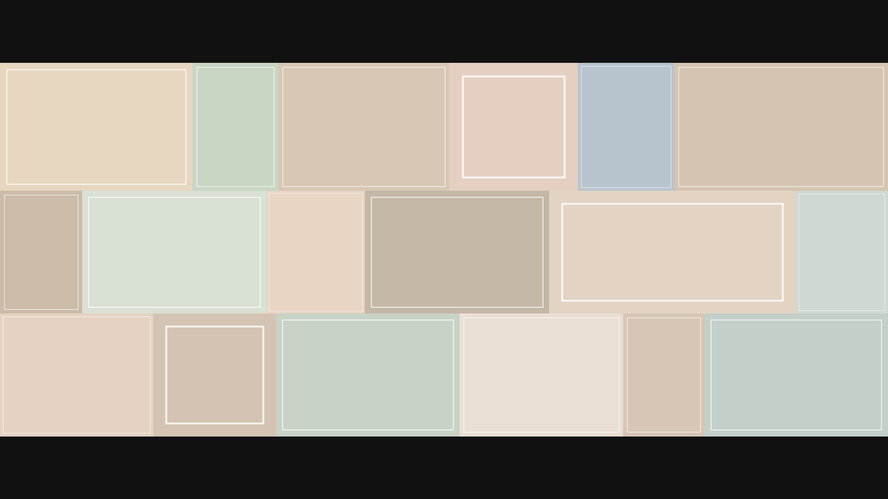

# Photowall

<p>
  <a href="README.md"></a>
  <a href="README.en.md"></a>
</p>

Look at many photos in one window. They sit in rows, uncropped. Zoom in and drag to look around.



You need [Python 3](https://www.python.org/downloads/).

```bash
python3 main.py
```

The first run installs the UI library from `requirements.txt` into `.venv`, then opens the window. Later runs use the same command.

On Windows, `py main.py` works if `python3` does not.

To install it yourself:

```bash
python3 -m venv .venv
.venv/bin/pip install -r requirements.txt
.venv/bin/python main.py
```

On Windows, use `.venv\Scripts` instead of `.venv/bin`.

Pick image files, or pick a folder. A folder asks whether to include photos in subfolders. Photos are placed in horizontal rows, and each one stays whole. Pinch on a trackpad, or press Command +/- on macOS and Ctrl +/- on Windows, to zoom toward the center. Then drag. Double-click a photo to view it alone; that view zooms too. Esc returns to the wall.

`.venv` and any photos in `resource` are not part of this repository.

[MIT](LICENSE)
