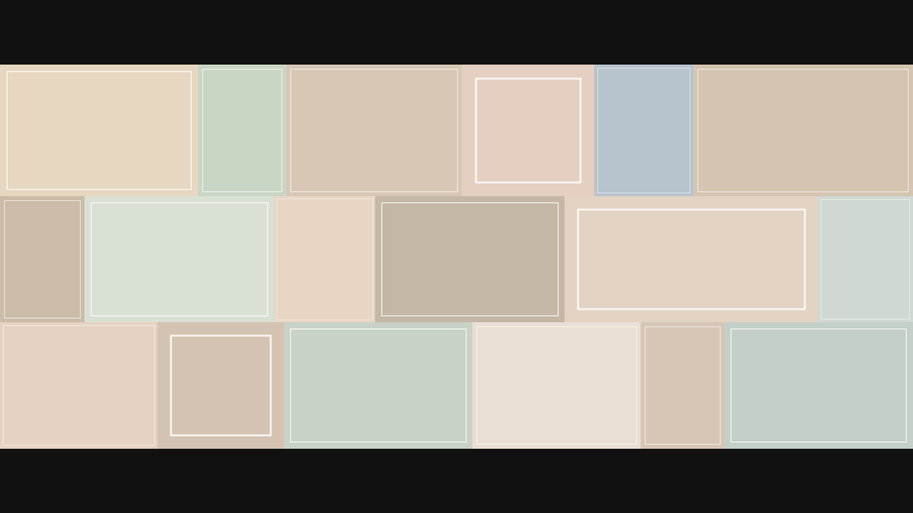

# 照片墙 Photowall

一个窗口里同时看很多张照片。横着排，不裁切。放大之后可以拖着看。

Look at many photos in one window. They sit in rows, uncropped. Zoom in and drag to look around.



## 中文

需要 [Python 3](https://www.python.org/downloads/)。

```bash
python3 main.py
```

第一次运行会按 `requirements.txt` 把界面库装进项目里的 `.venv`，然后打开窗口。之后还是这条命令。

Windows 上如果没有 `python3`，用 `py main.py`。

不想自动安装的话：

```bash
python3 -m venv .venv
.venv/bin/pip install -r requirements.txt
.venv/bin/python main.py
```

Windows 把 `.venv/bin` 换成 `.venv\Scripts`。

选图片，或者选一个文件夹。选文件夹时会问要不要把子文件夹里的照片也打开。照片横排铺开，每张都是完整的。触控板双指，或 macOS 的 ⌘+ / ⌘−、Windows 的 Ctrl+ / Ctrl−，朝画面中心放大，然后拖动。双击一张可以单独看，单张也能放大。Esc 回到照片墙。

`.venv` 和 `resource` 里的照片不会进这个仓库。

## English

You need [Python 3](https://www.python.org/downloads/).

```bash
python3 main.py
```

The first run installs the UI library from `requirements.txt` into `.venv`, then opens the window. Later runs use the same command.

On Windows, `py main.py` works if `python3` does not.

To install it yourself:

```bash
python3 -m venv .venv
.venv/bin/pip install -r requirements.txt
.venv/bin/python main.py
```

On Windows, use `.venv\Scripts` instead of `.venv/bin`.

Pick image files, or pick a folder. A folder asks whether to include photos in subfolders. Photos are placed in horizontal rows, and each one stays whole. Pinch on a trackpad, or press Command +/- on macOS and Ctrl +/- on Windows, to zoom toward the center. Then drag. Double-click a photo to view it alone; that view zooms too. Esc returns to the wall.

`.venv` and any photos in `resource` are not part of this repository.

## License

[MIT](LICENSE)
